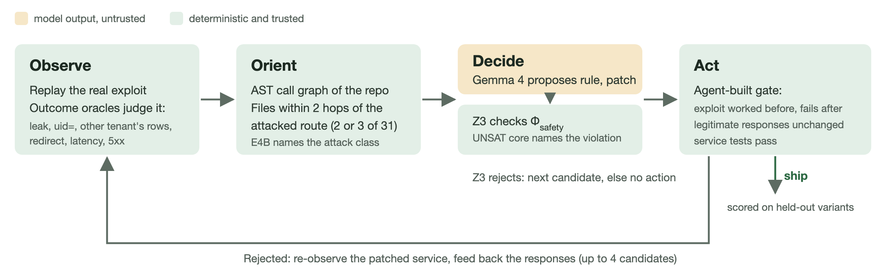

# OODA-Aegis

Exploit-grounded, constraint-verified program repair with small open models.

OODA-Aegis is an Observe, Orient, Decide, Act agent that repairs exploited code with Gemma 4 and treats every model output as an untrusted proposal. A static call graph finds the code an attack reaches, the Z3 SMT solver checks every proxy rule and patch before anything runs, and a gate the agent builds itself accepts a patch only when the real exploit worked before it, fails after it, and legitimate traffic is unchanged.



## Results at a glance

| Finding | Result |
|---|---|
| Verified fixes on AegisBench, full agent | 45 of 48 |
| Same model with only the route file, no code graph | 0 of 32 |
| Held-out exploit variants blocked by accepted fixes | 89 of 89 |
| The model's own test agreeing with the verifier | 56% |
| Gemma 4 E4B and 31B, verified fixes and median time to fix | 31 and 31 of 32, 35 s and 143 s |
| Bugs three to five call hops deep: call slice and whole repository | 27 and 15 of 32 verified |
| Real CVEs: exploits reproduced and regression suites passing | 13 of 13 and 13 of 13 |
| Real CVEs: bug reached by the call graph plus the exploit's trace | 13 of 13 |

Every number above is regenerated from the raw logs in this repository by one command.

## What is inside

**The agent** (`aegisbench/`). Exploit replay with outcome oracles (`oracle.py`, `sandbox.py`), code-graph retrieval (`codegraph.py`), Z3-checked edge rules and patches (`guard.py`), and multi-candidate repair with re-observation and an agent-built verification gate (`agent.py`).

**AegisBench**. Sixteen executable repair tasks in a multi-module FastAPI service (`aegisbench/service`), nine vulnerability classes, each with a real exploit, visible and held-out variants, legitimate requests and a reference fix (`aegisbench/tasks.py`). AegisBench-Deep (`deep.py`) moves each bug one to five call hops from its route, and adds dynamic dispatch, a decorator registry and an ORM-style manager as indirection.

**Real CVEs** (`aegisbench/realcve`). Thirteen CVEs in requests, urllib3, waitress, PyYAML, Jinja2, sqlparse, idna, python-multipart, aiohttp, Werkzeug and Django, pinned to their last vulnerable releases. Each has target functions checked against the fixed release (`cves.py --verify`), an exploit reproduction (`exploits.py`), the release's own regression tests (`regress.py`), the exploit's call trace, and a retrieval study over a code graph for real packages (`libgraph.py`, `cve_stats.py`). CVE-2021-33503 is also repaired end to end (`repair_urllib3.py`). Sources are fetched from PyPI with SHA-256 checks, not redistributed.

**Checks on patches**. Root-cause labels for every verified fix (`rootcause.py`), a dynamic-taint clause that needs no reference fix (`taint.py`), a static no-sanitizer-bypass clause (`sanitizer.py`), and the gate under non-deterministic responses (`semantic.py`).

**Raw results** (`aegisbench/results`). One JSON line per episode and every candidate patch: 400 GPU episodes, 96 AegisBench-Deep episodes, the real-CVE trials, offline replays, and CSV exports in `results/csv`.

## Paper

- `aegisbench/paper/preprint/ooda_aegis_ieee.pdf`, the full paper in IEEE two-column layout, with its LaTeX source
- `aegisbench/paper/preprint/ooda_aegis_preprint.pdf`, the same paper in a single-column layout
- `aegisbench/paper/writeup.md`, the short version

## Reproduce the paper

```bash
pip install -r requirements.txt
python -m aegisbench.realcve.cves      # once: fetch the pinned vulnerable and fixed releases
bash reproduce.sh                      # every table, replay, graph analysis, CSV and chart, from the raw logs, no GPU
bash reproduce.sh --validate           # also re-checks every exploit, reference fix, CVE exploit and regression suite
```

`reproduce.sh` ends by checking that every regenerated file matches the committed one. `--validate` runs the CVE releases' own code; run `python -m aegisbench.realcve.runtime` once first. That code runs in separate Python 3.12 processes with the network limited to 127.0.0.1.

## Re-run the experiments

Needs [Ollama](https://ollama.com) and the Gemma 4 models (`gemma4:e4b`, `gemma4:12b`, `gemma4:26b`, `gemma4:31b`).

```bash
python -m aegisbench.run --edge gemma4:e4b --repair gemma4:26b \
  --configs full,no_tot,no_graph_route,no_graph_flat,no_evidence,no_guard --trials 2 --out results/main.jsonl
python -m aegisbench.run --edge gemma4:e4b --repair gemma4:26b --inject --out results/inject.jsonl
python -m aegisbench.run --edge gemma4:e4b --repair gemma4:e4b --trials 2 --out results/sizes.jsonl
python -m aegisbench.run --edge gemma4:e4b --repair gemma4:e4b --configs graph_slice,full,no_graph_flat --depth 3 --out deep3.jsonl
python -m aegisbench.realcve.repair_urllib3 --repair gemma4:e4b --trials 5 --out urllib3_redos.jsonl
```

The GPU runs used two NVIDIA T4 GPUs; `aegisbench/kaggle/make_kernel.py` builds the notebook that ran them.

## Citing

```bibtex
@misc{kumar2026oodaaegis,
  title  = {OODA-Aegis: Exploit-Grounded, Constraint-Verified Program Repair with Code-Graph Retrieval and SMT Guardrails},
  author = {Kumar, Nikhil and Singh, Suryansh Pratap and Jha, Raj},
  year   = {2026},
  url    = {https://github.com/CopyNinja07-07/aegis}
}
```

## Authors

Nikhil Kumar (lead author), Suryansh Pratap Singh and Raj Jha.

## Safety note

The service in `aegisbench/service` and the fetched CVE releases are deliberately vulnerable. Run them only locally, in a sandbox. The secrets in the service's `.env` are canary strings.

## License

Apache 2.0.
